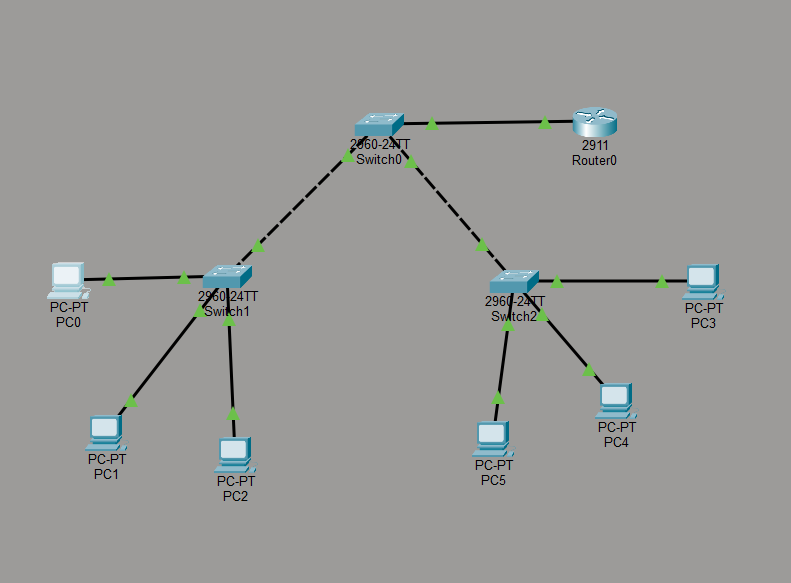

# VLAN-Segmentation-Lab
VLAN segmentation and trunk configuration using Cisco Packet tracer
VLAN Segmentation Lab

# VLAN Segmentation Lab

## Overview
A Cisco Packet Tracer lab focused on VLAN segmentation and Layer 2 switching.

## Network Topology

## VLAN Addressing Plan

| VLAN ID | Department | Subnet |
|---|---|---|
| 10 | Sales | 10.0.0.0/24 |
| 20 | HR | 172.16.0.0/24 |
| 30 | IT | 192.168.0.0/24 |
| 99 | Native VLAN | Native VLAN |

## Technologies
- Cisco Packet Tracer
- VLAN configuration
- Access ports
- 802.1Q trunking
- IP addressing and subnetting
- Network connectivity testing

## Verification
Add the actual results of `show vlan brief`, `show interfaces trunk`, and connectivity tests.

## Project Status
In progress — configuration and verification are being completed.

## Files
- `VLAN-Segmentation-Lab.pkt` — Packet Tracer project
- `topology.png` — Network topology diagram
